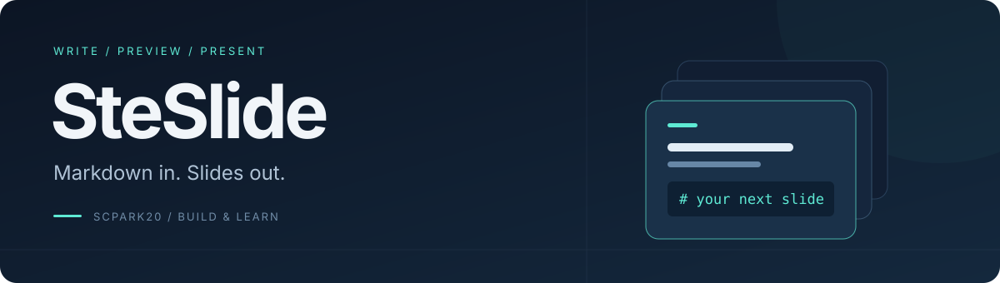

<p align="center">
  
</p>

<p align="center">
  <a href="https://www.python.org/"></a>
  <a href="https://github.com/marp-team/marp-cli"></a>
  
</p>

<p align="center">
  <strong>Markdown을 편집하고, 슬라이드 변화를 바로 확인하세요.</strong><br>
  채팅에서 고치고 · 브라우저에서 보고 · PDF로 공유합니다.
</p>

<p align="center">
  <a href="docs/usage.md">사용 가이드</a> ·
  <a href="docs/architecture.md">동작 구조</a> ·
  <a href="docs/maintenance.md">업데이트</a> ·
  <a href="https://github.com/scpark20/SteAgent">SteAgent</a>
</p>

---

## 작은 파일에서 하나의 강의로

| 구성 | 하는 일 |
| --- | --- |
| **Lecture → Chapter → Section** | 원본을 나눠 쓰고 상위 미리보기에서 모아 봅니다. |
| **저장하면 화면에 반영** | Markdown과 CSS 편집이 브라우저 슬라이드에 이어집니다. |
| **프로젝트마다 재사용** | Git 서브모듈로 연결해 공통 도구를 같은 저장소에서 관리합니다. |

강의 원본은 사용하는 프로젝트에, 생성기와 공통 테마는 SteSlide에 둡니다. 기본 템플릿은 빈 상태로 시작합니다.

## 빠른 시작

**Python 3.10+ · Git**이 필요합니다. 사용할 프로젝트의 Git 저장소 루트에서 실행하세요.

```bash
git submodule add -b main https://github.com/scpark20/SteSlide.git tools/steslide
python3 tools/steslide/scripts/setup_marp.py
python3 tools/steslide/steslide.py init
python3 tools/steslide/steslide.py preview
```

**[localhost:8766/lecture.md](http://localhost:8766/lecture.md)**를 열고 `lectures/lecture-01/chapter-01/section-01.md`를 편집하면 됩니다. 채팅으로 수정하려면 프로젝트 파일에 접근할 수 있는 코딩 도구를 사용하세요.

Remote SSH, VS Code 미리보기, PDF 내보내기와 명령어 옵션은 [사용 가이드](docs/usage.md)에 있습니다.

## 문서

- [사용 가이드](docs/usage.md) — 설치, 미리보기, PDF·HTML 내보내기
- [동작 구조](docs/architecture.md) — 파일 계층, 합본 생성, 변경 감지
- [유지보수](docs/maintenance.md) — 도구 수정, SteSlide에 반영, 프로젝트 업데이트

Built with [Marp](https://github.com/marp-team/marp-cli). Used by [SteAgent](https://github.com/scpark20/SteAgent).
